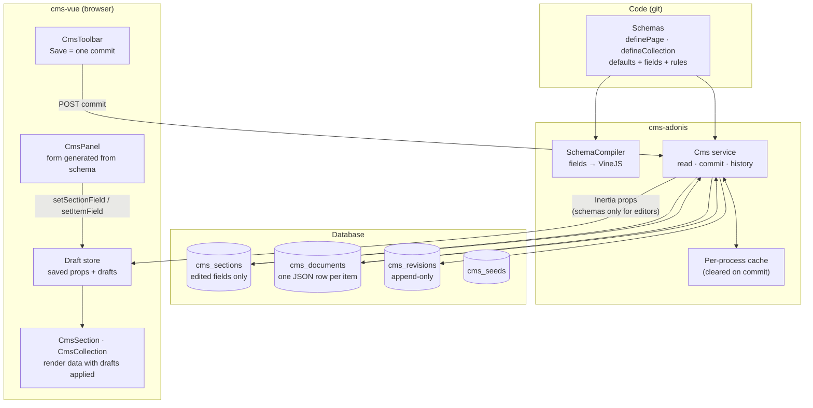
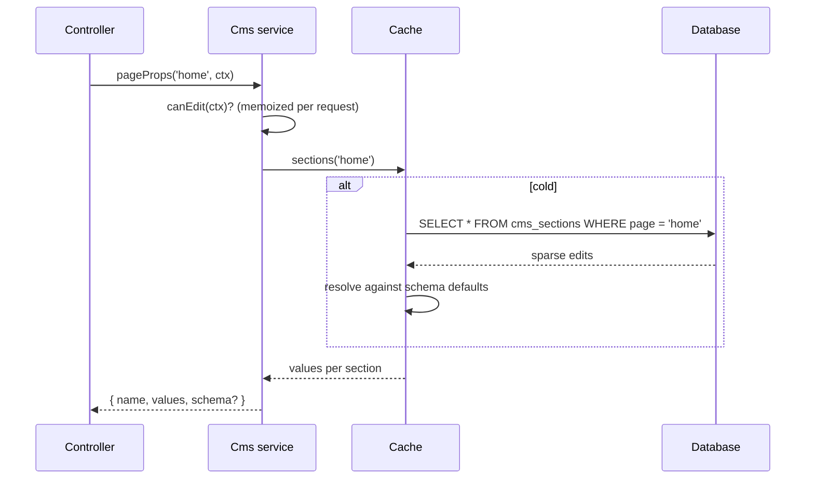
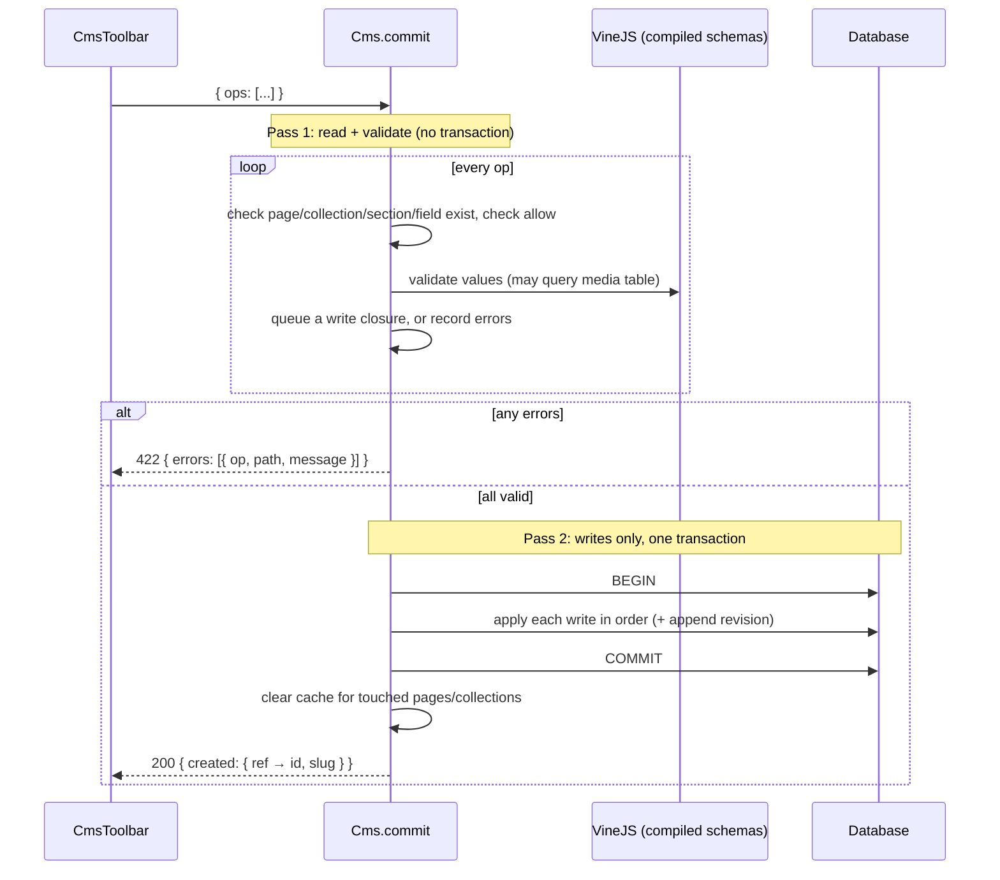
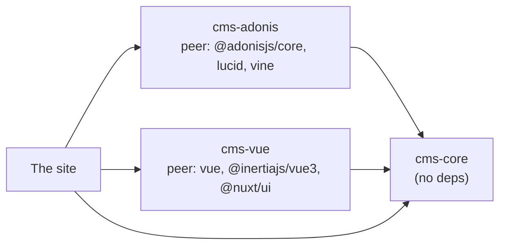

# Architecture

This explains how the pieces fit together, and what the system guarantees.

## The model in one picture



There are three kinds of state, and the design follows from keeping them apart:

| State                    | Lives in        | Who changes it       | Lifetime                       |
| ------------------------ | --------------- | -------------------- | ------------------------------ |
| **Structure + defaults** | Schemas in code | Developers, via git  | Deploys                        |
| **Saved content**        | `cms_*` tables  | Editors, via commits | Permanent (with history)       |
| **Drafts**               | Browser memory  | One editor           | Until Save, Discard or leaving |

## Content kinds

### Sections (`definePage` + `section`)

A section is one block of a page: a hero, a banner, the footer. Its values are **code defaults overlaid with edits**:

```
resolved = normalizeFields(section.fields, storedEdits)
           └─ every field: stored value if valid for its type, else default
```

`cms_sections` stores only the fields someone changed, as one JSON object per (page, section). Some consequences:

- An empty database renders exactly what's in code. New sites, tests and preview environments need no seeding.
- Changing a default in code updates every site that hasn't edited that field.
- **Reset** removes the key, and the default shows again.
- When a schema changes underneath stored data, `normalize` reconciles it at read time. Unknown keys are dropped, missing keys get defaults, and values of the wrong shape fall back to the default. Nothing crashes, and no migration is needed.

A "page" is just a named set of sections. Site-wide content (header, footer) is a page too (`site`); the app shares it with every response.

### Collections (`defineCollection`)

Collections are lists of records: locations, specials, menu items. Each item is one row in `cms_documents`:

```
id · collection · slug · data (JSON) · sort_order · hidden · created_by · updated_by · timestamps
```

- **Slugs** are generated once from `slugFrom` (made unique with `-2`, `-3`…) and never change, because they're usually part of URLs.
- **`hidden`** keeps an item without showing it. Editors still receive hidden items, visitors don't.
- **`allow`** gates create, delete, reorder and hide for each collection. The server enforces it, and the UI just hides the buttons.
- **`initial`** items are inserted the first time a collection is read, and that's recorded in `cms_seeds`. They never come back, so items staff delete stay deleted. (A seeder that runs on every boot would resurrect them, so the CMS doesn't use seeders.)

## Read path



- **Visitors get values only.** `schema` (the field definitions) is included only when `authorize(ctx)` passes, which keeps public payloads small and doesn't reveal what's editable.
- **Collections** go through the same path with `collectionProps(name, ctx)`. Editors also get hidden items.
- **The cache** is a `Map` in the process, filled lazily and cleared for the touched page or collection after each commit. With several app processes, each keeps its own cache and only sees another process's commit after a restart. See [the roadmap](roadmap.md#multi-process-cache) for the fix. A single process (the current deployment) is always consistent.

## Write path: the commit

Every save, from one field to a whole session of edits, is **one commit**: an ordered list of ops sent to `POST /admin/cms/commit` (see [protocol.md](protocol.md)).



Why two passes:

1. **Atomicity without holding locks during validation.** Validators can query the database (does this image exist?). SQLite has a single connection, so validating inside the transaction deadlocks. On Postgres it would just hold the transaction open longer than needed.
2. **Every error at once.** Pass 1 keeps going after a failure, so the editor sees every invalid field in one round trip.

Some checks can only happen at write time. For example, reorder needs the ids of items created earlier in the same commit. Those throw inside the transaction, which rolls everything back and reports a 422 on that op.

## The draft store (browser)

`cms-vue`'s store is a single reactive object:

```
editor
├── pages{}          saved PageProps, registered by <CmsPage>
├── collections{}    saved CollectionProps, registered by <CmsCollection> or the layout
├── sectionDrafts{}  "section:home.hero" → { changes, reset[] }
├── collectionDrafts{} "locations" → { creates[], updates{id: {data, hidden}}, deletes[], order }
├── errors{}         target key → field path → message (from a 422)
├── panel            what the slide-out shows
└── history          what the history modal shows
```

**Rendering always goes through the store.** `sectionValues()` and `collectionItems()` return the saved values with drafts applied. That's why previewing an edit needs no special code on the page. Anything that reads through the store, including the header nav or JSON-LD on another part of the page, updates as you type.

**Drafts erase themselves.** Setting a field back to its saved value removes the draft, so the unsaved-count badge stays honest.

**Saving** turns drafts into ops in this order: sections, then each collection's creates → updates → deletes → reorder. It keeps a parallel array mapping each op index to its draft, so the server's `{ op, path }` errors can be pinned to the right form field.

## Guarantees and invariants

| Guarantee                                                        | Enforced by                                           |
| ---------------------------------------------------------------- | ----------------------------------------------------- |
| A commit applies entirely or not at all                          | Two-pass commit, single transaction                   |
| Stored values always passed the schema's validation when written | `SchemaCompiler` in pass 1                            |
| Rendering never fails because of stale stored data               | `normalize` at read time                              |
| Schemas are never sent to visitors                               | `pageProps` / `collectionProps` check `authorize`     |
| Every write is attributable and recoverable                      | Append-only `cms_revisions` with a user snapshot      |
| Slugs never change after creation                                | Slugs are generated only on create                    |
| Seed data is inserted at most once per collection                | `cms_seeds` primary key                               |
| Media used by content can't be deleted                           | `mediaKeysInUse()` walks defaults, sections and items |
| Bad schemas fail at boot, not on first save                      | `Cms` compiles every schema in its constructor        |

## Extension points (today)

| Extension                  | How                                                                     |
| -------------------------- | ----------------------------------------------------------------------- |
| New field type             | `defineFieldType` (server) + `fields: { name: Component }` (client)     |
| Who may edit               | `authorize(ctx)` in `config/cms.ts`                                     |
| Who gets credit in history | `user(ctx)` in `config/cms.ts`                                          |
| Media existence check      | `media.exists(key, folder)` in `config/cms.ts`                          |
| Media picker UI            | `mediaPicker` plugin option                                             |
| Media URLs                 | `media.baseUrl` (server) + `mediaUrl` plugin option (client)            |
| Media folders              | `folder` on `f.image` / `f.file` / `f.link`, `linkFolder` plugin option |
| Table names                | `tablePrefix` in `config/cms.ts`                                        |
| Toolbar entries            | `<CmsToolbar :shortcuts>` for sections that aren't visible as a block   |

## Package boundaries



- `cms-core` never imports from the other two. Anything both sides need (types, defaults, normalization, the wire protocol) lives there.
- `cms-vue` never imports from the app. The media picker and custom field editors are _injected_ through plugin options.
- `cms-adonis` never imports app models. Users, media and authorization reach it through config callbacks.
